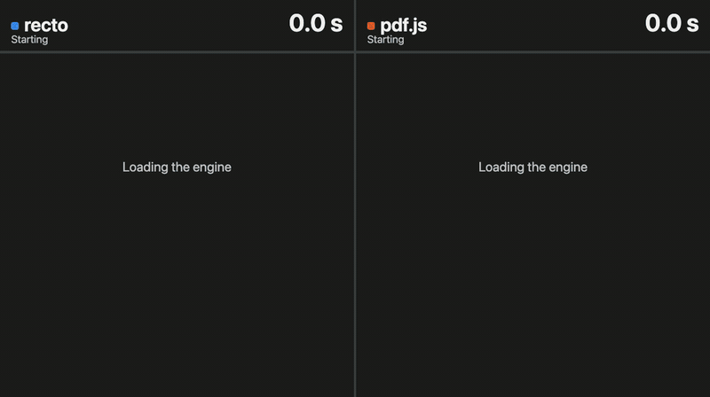
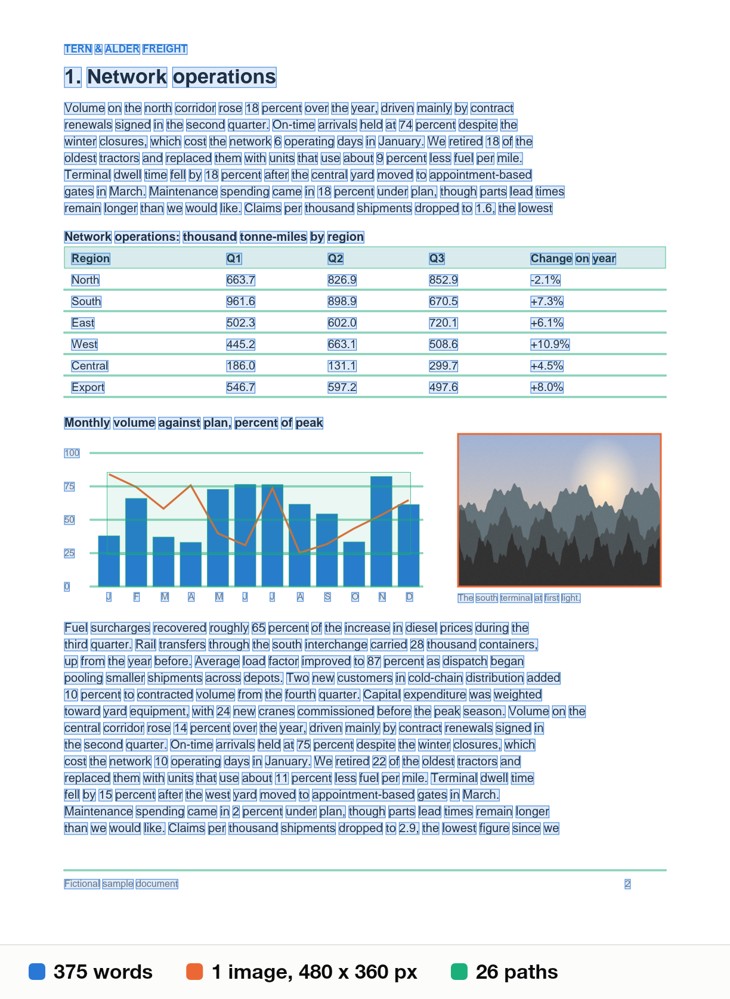
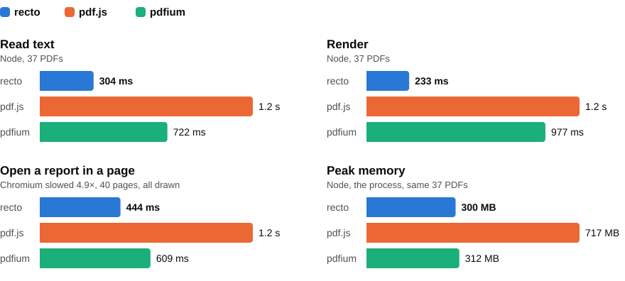

<h1 align="center">recto</h1>
<p align="center">A PDF engine for JavaScript: text with positions, page objects and rendering, in Rust compiled to WebAssembly.</p>
<p align="center">
  <a href="#use-it">Get started</a> ·
  <a href="docs/reference.md">Reference</a> ·
  <a href="docs/benchmarks.md">Benchmarks</a> ·
  <a href="docs/how-it-works.md">How it works</a>
</p>



*A real recording of 240 generated report pages drawn at 800 px, each engine alone, side by side
afterwards, in Chromium with the CPU slowed 4.5×. The counters are measured in the page.*

## Use it

```sh
npm install @2018kguo/recto
```

recto opens a PDF and gives you each page's text, the box and font of every character, its images,
paths, annotations and bookmarks, and a rendered bitmap. It has no runtime dependencies and no install
scripts, and the built WebAssembly ships in the package, so you don't need Rust.

```js
import { readFile } from "node:fs/promises";
import { openPdf } from "@2018kguo/recto";

const bytes = await readFile("report.pdf");
await using doc = await openPdf(bytes);
console.log(doc.pageCount, doc.text(0).text);
const { width, height, rgba } = doc.render(0, { width: 1024 });
console.log(width, height, rgba.length);
```

That is all the setup: fonts and CMaps load from the package when a document first needs them.
`using` closes the document; so does `doc.close()`. The bytes are copied, so you can reuse the
buffer as soon as `openPdf` returns.

**Every call is synchronous CPU work**, except `await doc.renderAsync(0, { width, signal })`, which
gives the thread back between slices and can be stopped. The others block the thread they run on, so
a server should not run them on its main loop. Put them on a worker thread:

```js
// pdf-thread.js
import { parentPort } from "node:worker_threads";
import { openPdf } from "@2018kguo/recto";

parentPort.on("message", async (bytes) => {
  using doc = await openPdf(bytes);
  const pages = [];
  for (let i = 0; i < doc.pageCount; i++) pages.push(doc.text(i).text);
  parentPort.postMessage(pages);
});
```

```js
// server.js
import { readFile } from "node:fs/promises";
import { Worker } from "node:worker_threads";

const thread = new Worker(new URL("./pdf-thread.js", import.meta.url));
thread.once("message", (pages) => {
  console.log(pages);
  thread.terminate();
});
thread.postMessage(await readFile("report.pdf"));
```

recto has no thread pool of its own; how many threads you want is up to you.

### In a browser

Put it in a dedicated Web Worker. A bundler that understands `new URL(…, import.meta.url)` finds the
WebAssembly and fonts by itself ([which ones were tested](docs/reference.md#setup-per-environment)).
No special headers are needed.

```js
// pdf-worker.js
import { openPdf } from "@2018kguo/recto";

self.onmessage = async ({ data: bytes }) => {
  using doc = await openPdf(bytes);
  const { width, height, rgba } = doc.render(0, { width: 1024 });
  self.postMessage({ text: doc.text(0).text, width, height, rgba }, [rgba.buffer]);
};
```

```js
// main.js
const worker = new Worker(new URL("./pdf-worker.js", import.meta.url), { type: "module" });
worker.onmessage = ({ data }) => console.log(data.text);
worker.postMessage(await (await fetch("/report.pdf")).arrayBuffer());
```

It also runs on a page's main thread and in a service worker, where it fetches its assets when the
engine is created, but on a main thread the page freezes for the length of each call.

### When things go wrong

Every failure is a `PdfError` with a `code` to branch on:

```js
import { openPdf, PdfError } from "@2018kguo/recto";

try {
  using doc = await openPdf(bytes, { password });
  // ...
} catch (error) {
  if (!(error instanceof PdfError)) throw error;
  if (error.code === "password-required" || error.code === "wrong-password") askAgain();
  else if (error.code === "invalid-file") reject();
  else throw error;
}
```

If the WebAssembly instance crashes, documents open on it fail with `crash` and the next open
gets a fresh one. A missing font file throws `missing-asset` from the call that needed it. It
never reads as blank text. The [reference](docs/reference.md#errors) lists every code.

### Only the bytes you read

`engine.openRanged(url)` fetches just the parts of the file the parser needs:

```js
import { createPdfEngine } from "@2018kguo/recto";

const engine = await createPdfEngine();
using doc = await engine.openRanged("https://example.com/large.pdf");
doc.pageCount;
doc.stats().bytesFetched;
```

A read that misses blocks its thread for the round trip, so run it on a worker thread. A server
that ignores `Range` is read whole, within `maxBytes`; a wrong answer fails clearly. See
[ranged reads](docs/reference.md#ranged-reads).

## What you get back



A page of the generated report, with what the API returned drawn over it: `text(i)`, `objects(i)` and
`render(i)`. The boxes are loose font boxes, not glyph ink.

## How fast

<picture>
  <source media="(prefers-color-scheme: dark)" srcset="docs/benchmarks-dark.svg">
  
</picture>

Medians of 3 alternating runs on an Apple M5 Pro, with 37 public and generated PDFs in Node and 8 of them in Chromium, against
pdf.js 6.5.438 and stock pdfium. How much faster recto is than each:

| | pdf.js | pdfium |
|---|---:|---:|
| Text in Node | 3.8× | 2.3× |
| Render in Node | 5.2× | 4.3× |
| Text in Chromium | 3.3× | 2.6× |
| Render in Chromium | 3.6× | 1.5× |

It isn't ahead everywhere. In a browser pdfium reaches a fresh page's first pixels sooner (66 ms against
54 ms), though recto is first to text (32 ms against 55 ms and 43 ms). pdf.js downloads less: 0.42 MB with
brotli, against recto's 0.53 MB for text and 1.72 MB for text and pixels (1.22 MB if the thread asks for the
full engine up front). pdfium opens a large file a little faster. pdf.js holds less memory in a page. On text
quality against poppler the three tie. [benchmarks.md](docs/benchmarks.md) has all of it, what each
number means and how it's measured. To rerun it on PDFs of your own (it commits none):

```sh
npm run build
npm run bench -- path/to/pdfs
npm run bench:browser -- path/to/pdfs
```

These numbers say how fast, not how good: they don't compare rendered pixels.

## Why not pdf.js or pdfium

I started with pdf.js. It's the right choice for a viewer: it comes with one, plus annotations, forms,
a mature text layer and rendering that has seen nearly every odd file there is. I wasn't building a
viewer. I wanted the text and the pixels of a lot of pages, and that's where it hurt: the time per
page, a canvas package to render at all in Node (without `@napi-rs/canvas` a render fails with "Cannot
find module"), and a default that downloads a whole file to read one page, though two options bring
it level with recto.

Then I tried pdfium compiled to WebAssembly. Its fidelity is excellent, and Chrome has been testing it
for years. I maintained a fork with a queue of patches, built reproducibly in a pinned container, and
it got materially better, then plateaued. It's single-threaded, and build flags didn't change that.
The rest of the gain needed changes at the level of the architecture: an interpreter that only
reads text, ranged reads inside the parser, assets that load only when they're needed. That's slow
going in a large C++ codebase, and a memory bug there traps the whole instance.

So recto is built on [hayro](https://github.com/LaurenzV/hayro), in Rust, where I could make those
changes. Four of its five vendored crates forbid `unsafe` outright; `hayro-syntax` has a little, and
so does recto. A panic still takes the instance with it, and recto reports that as `crash`.

What that costs: there's no viewer. It's much younger than either, and less tested on odd files. Some
rendering is approximate, and char boxes are loose. If you need a viewer or the most faithful pixels
on anything a user might upload, use one of those two.

## What's in the package

| File | Size | When it loads |
|---|---:|---|
| `wasm/recto-text.wasm` | 1.7 MB (0.50 MB brotli) | Creating an engine |
| `wasm/recto.wasm` | 3.8 MB (0.98 MB brotli) | The first `render` or `objects`, or a main thread's engine unless you leave it out |
| `wasm/recto.gen.mjs`, `dist/` | 32 KB, 73 KB of JavaScript | Importing the package |
| `wasm/fonts.bin` | 0.26 MB | A document names a standard font it doesn't embed |
| `wasm/cmaps.deflate` | 0.36 MB | A document uses a predefined CJK CMap |
| `wasm/cjk-fallback.ttf` | 5.1 MB | Rendering CJK from a font the document doesn't embed |

## Limits

- **Threads:** every call but `renderAsync` blocks its thread and can't be interrupted, only its worker
  terminated. `renderAsync` still holds the thread for the last, rasterizing step of a render. A
  ranged read needs a worker. An edge runtime without synchronous requests should work
  the way a service worker does, but none has been run.
- **Memory:** `open` copies the file into WebAssembly memory, which only comes back when an instance is
  dropped (a second after the last close, past 64 MiB by default). A ranged file can be up to 3.5 GiB.
- **Ranged reads trust `/Count`:** a file whose `/Count` values lie where the path to a page doesn't look
  can return a different page than a whole-file read. Open the whole file if you need the guarantee. See
  [ranged reads](docs/reference.md#ranged-reads).
- **Char boxes** are loose font boxes, not glyph ink. A font that states no ascent and descent gets 0.8
  and −0.2 em. A fill colour reads as the stroke colour for stroke-only text, and as opaque black for a
  pattern.
- **Hostile pages:** past 2^19 glyphs, 2^21 path segments or 2^19 images on a page, the rest is left out
  and `truncated` is true on the result.
- **Rendering:** transparency follows the spec in the cases [tested](docs/benchmarks.md#rendering), and
  disagrees with poppler and pdfium on knockout, where they don't follow it. Still approximate: a
  non-isolated group that needs its backdrop inside another such group stays isolated, and so does any
  past the 32nd on a page (`truncated` says so), and a subgroup inside a non-isolated blended knockout
  group is close but not exact. Rendered pixels haven't been compared at scale with other engines.
- **Encryption:** the Standard security handler only, so a public-key file fails with `unsupported`. An
  encrypted file before revision 6 that lost its trailer fails with `invalid-file`, since its key needs
  the trailer's ID. Revision 6 is repaired.
- **Not here, by choice:** writing or editing PDFs, filling forms, OCR. A scanned page has no text.

Tested on Node 24 and 25, and in Chromium, Firefox and WebKit. CI runs Node 24 and Chromium; Firefox
and WebKit are run by hand.

## Documentation

- [reference.md](docs/reference.md): the whole API, every error code, ranged reads, setup per environment
- [benchmarks.md](docs/benchmarks.md): every number, how it's measured, how to rerun it
- [how-it-works.md](docs/how-it-works.md): the text layer, assets, transparency groups, ranged reads, instances
- [development.md](docs/development.md): building it, tests, the repository layout

## License

MIT. recto is built on [hayro](https://github.com/LaurenzV/hayro) (MIT or Apache-2.0). `vendor/` holds
patched copies of five of its crates, with their licences and a [note on what changed](vendor/README.md).
The Foxit fonts are BSD-licensed and the Droid Sans fallback Apache-2.0; `wasm/THIRD_PARTY_NOTICES` in
the package has these and every compiled crate's licence.
